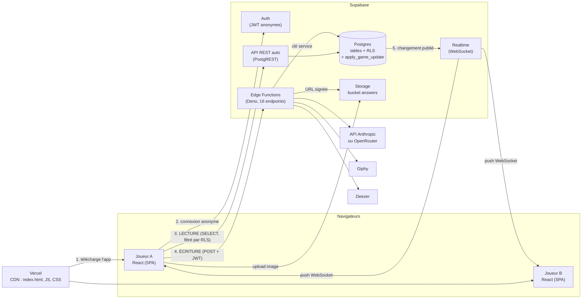
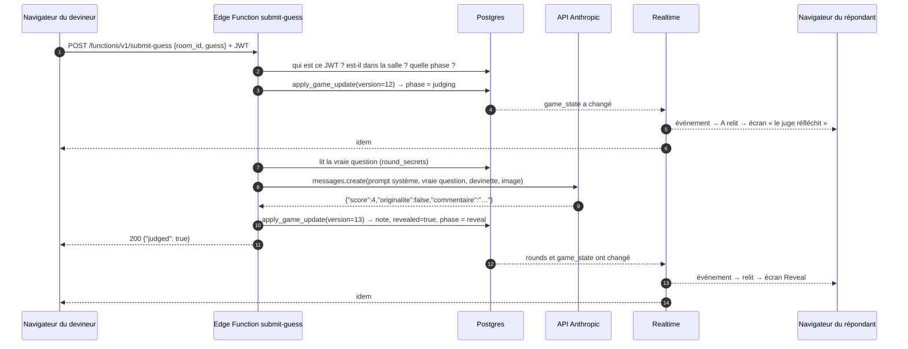
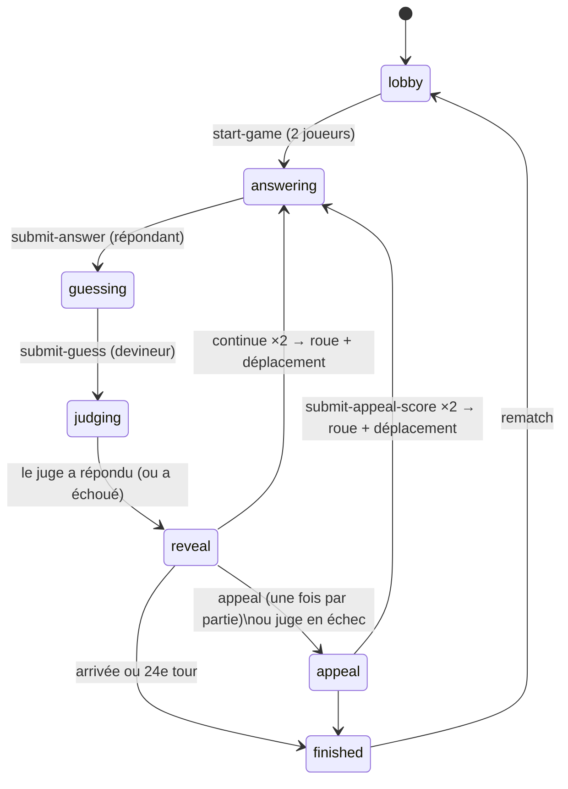

# Comprendre « Devine la question » de l'intérieur

> Document de synthèse pour quelqu'un qui sort de **Webserv** et d'**Inception** à 42.
> Tu sais ce qu'est une requête HTTP, un code de statut, un CGI, un conteneur, nginx, MariaDB, un `.env`.
> Ici, on part de là pour comprendre comment un vrai projet relie un **front**, un **hébergeur**,
> une **base de données**, des **fonctions serveur** et un **appel à une IA**.

Les liens pointent vers les vrais fichiers du dépôt : clique dessus pour aller voir le code.

## Sommaire

- [Partie 1 — Vue globale de l'architecture](#partie-1--vue-globale-de-larchitecture)
  - [1.1 Le jeu en cinq lignes](#11-le-jeu-en-cinq-lignes)
  - [1.2 Le schéma d'ensemble](#12-le-schéma-densemble)
  - [1.3 Le parallèle avec Inception](#13-le-parallèle-avec-inception)
  - [1.4 Deux chemins : lire et écrire](#14-deux-chemins--lire-et-écrire)
  - [1.5 Une action de bout en bout](#15-une-action-de-bout-en-bout)
  - [1.6 La machine à états d'un tour](#16-la-machine-à-états-dun-tour)
  - [1.7 La carte du dépôt](#17-la-carte-du-dépôt)
- [Partie 2 — Les technologies, une par une](#partie-2--les-technologies-une-par-une)
  - [2.1 TypeScript](#21-typescript)
  - [2.2 React, Vite, Tailwind, framer-motion](#22-react-vite-tailwind-framer-motion)
  - [2.3 Vercel](#23-vercel)
  - [2.4 Supabase](#24-supabase)
  - [2.5 L'appel à l'IA : le juge](#25-lappel-à-lia--le-juge)
  - [2.6 Les API tierces : Giphy et Deezer](#26-les-api-tierces--giphy-et-deezer)
  - [2.7 Tests et vérifications](#27-tests-et-vérifications)
- [Partie 3 — Synthèse](#partie-3--synthèse)

---

# Partie 1 — Vue globale de l'architecture

## 1.1 Le jeu en cinq lignes

- Deux joueurs, chacun sur son appareil, rejoignent une **salle** avec un code de 4 lettres.
- À chaque tour, l'un reçoit une **question secrète** et y répond avec un média imposé (un mot, des emojis, un dessin, une photo, une musique, un GIF…).
- L'autre voit la réponse et **devine la question**.
- Une **IA (Claude Haiku)** note de 0 à 5 la proximité entre la vraie question et la question devinée.
- La note règle une **roue** qui fait avancer un pion commun sur un plateau de 63 cases. Il faut arriver au bout en 24 tours.

Ce qui rend le projet intéressant techniquement :

1. **Temps réel** : quand l'un agit, l'écran de l'autre change tout seul, sans recharger.
2. **Secret** : le devineur ne doit **jamais** pouvoir lire la question, même en fouillant l'onglet Réseau.
3. **Anti-triche** : un joueur ne doit pas pouvoir s'attribuer un 5/5 en bricolant une requête.
4. **IA** : la clé d'API coûte de l'argent, elle ne doit jamais arriver dans le navigateur.

Toute l'architecture découle de ces quatre contraintes.

## 1.2 Le schéma d'ensemble



Version texte, si le diagramme ne s'affiche pas :

```text
                  ┌────────────── Vercel (CDN) ──────────────┐
                  │  index.html + bundle JS/CSS (statique)   │
                  └──────────────┬───────────────────────────┘
                                 │ 1. GET /  (une seule fois)
                                 ▼
 ┌──────────────┐       ┌──────────────────┐
 │  Joueur A    │       │  Joueur B        │      navigateurs = code React
 └──┬───┬───▲───┘       └──────────▲───────┘
    │   │   │ 5. push WebSocket    │
    │   │   └──────────────┬───────┘
    │   │                  │
    │   │ 4. POST /functions/v1/submit-guess  (Authorization: Bearer <JWT>)
    │   ▼                  │
    │ ┌───────────────────────────── Supabase ───────────────────────────────┐
    │ │ Edge Functions (Deno) ──clé service──▶ Postgres ──▶ Realtime ─────────┘
    │ │       │    │                          (tables, RLS, apply_game_update)
    │ │       │    └──▶ Storage (bucket "answers")
    │ │       └──▶ API Anthropic / OpenRouter, Giphy, Deezer
    │ └───────────────────────────────────────────────────────────────────────
    │ 3. GET /rest/v1/game_state?room_id=eq.…   (lecture, filtrée par la RLS)
    └──────────▶ PostgREST ──▶ Postgres
```

Retiens les cinq flèches numérotées : **télécharger l'app**, **s'identifier**, **lire**, **écrire**, **être prévenu**.

## 1.3 Le parallèle avec Inception

Dans Inception, tu montais toi-même tes services dans des conteneurs. Ici, presque tout est **managé** : quelqu'un d'autre fait tourner les serveurs, toi tu écris seulement la configuration et le code métier.

| Dans Inception, tu faisais… | Ici, c'est… | Où le voir |
| --- | --- | --- |
| Un conteneur **nginx** avec TLS qui sert les fichiers | **Vercel** : CDN mondial, HTTPS automatique | [vercel.json](../vercel.json) |
| Un conteneur **php-fpm** qui exécute WordPress à chaque requête | **Edge Functions** : un petit programme TypeScript exécuté à chaque requête | [supabase/functions/](../supabase/functions/) |
| Un conteneur **MariaDB** avec un script d'init SQL | **Postgres managé** par Supabase, avec des **migrations** SQL | [supabase/migrations/](../supabase/migrations/) |
| Les comptes WordPress (admin, user) | **Supabase Auth**, ici en mode anonyme | [src/lib/supabase.ts](../src/lib/supabase.ts) |
| Un **volume** Docker pour les fichiers uploadés | **Supabase Storage** (bucket `answers`) | [migration v2, l.133](../supabase/migrations/20261117000000_v2.sql#L133) |
| `.env` + `secrets/` lus par docker-compose | `VITE_*` (publics, dans le front) et `supabase secrets set` (privés, côté serveur) | [.env.example](../.env.example) |
| `docker-compose up` | `npx supabase db push`, `npm run deploy:functions`, push sur GitHub → Vercel rebuild | [README.md](../README.md) |
| Le réseau Docker interne entre conteneurs | Internet + HTTPS + JWT entre les services | — |

Ce que tu **ne fais plus** : patcher un OS, configurer un certificat, redémarrer un service, gérer la taille du disque. Ce que tu **fais toujours** : décider qui a le droit de lire/écrire quoi, protéger les secrets, gérer les erreurs.

## 1.4 Deux chemins : lire et écrire

C'est **l'idée la plus importante** du projet. Les lectures et les écritures ne prennent pas le même chemin.

### Lire : directement dans la base

Le navigateur interroge Postgres **directement** (via l'API REST que Supabase génère automatiquement à partir des tables). Exemple dans [src/lib/useGame.ts:24-29](../src/lib/useGame.ts#L24-L29) :

```ts
const [room, players, game, rounds] = await Promise.all([
  supabase.from("rooms").select("id, code, status").eq("id", roomId).maybeSingle(),
  supabase.from("players").select("*").eq("room_id", roomId).order("seat"),
  supabase.from("game_state").select("*").eq("room_id", roomId).maybeSingle(),
  supabase.from("rounds").select("*").eq("room_id", roomId).order("turn_number"),
]);
```

Sous le capot, chaque ligne devient une requête HTTP du genre :

```http
GET /rest/v1/game_state?select=*&room_id=eq.3f1c… HTTP/1.1
apikey: <clé anon>
Authorization: Bearer <JWT du joueur>
```

« Mais alors n'importe qui peut lire n'importe quelle salle ? » Non : la **RLS** (Row Level Security, voir [2.4](#row-level-security-rls--le-videur-de-la-base)) filtre les lignes dans Postgres lui-même, selon qui fait la requête. Si tu n'es pas dans la salle, tu reçois `[]`.

### Écrire : toujours via une Edge Function

Le navigateur n'a **aucun droit d'écriture** sur les tables. Pour agir, il appelle une Edge Function, qui vérifie tout puis écrit avec une clé spéciale (la clé service). Toutes les écritures du front sont regroupées dans [src/lib/actions.ts](../src/lib/actions.ts) :

```ts
export const actions = {
  createRoom: (name: string) => call("create-room", { name }),
  submitAnswer: (room_id: string, answer: string) => call("submit-answer", { room_id, answer }),
  submitGuess: (room_id: string, guess?: string) => call("submit-guess", { room_id, guess }),
  continueTurn: (room_id: string) => call("continue", { room_id }),
  // …
};
```

### Pourquoi cette asymétrie ?

Parce que **le client ment**. N'importe qui peut ouvrir la console et envoyer `UPDATE rounds SET llm_score = 5`. Si le client pouvait écrire, il n'y aurait pas de règles. On appelle ça un **serveur autoritaire** : le serveur est la seule source de vérité, le client se contente d'afficher et de demander.

C'est le même réflexe que dans Webserv : tu ne fais jamais confiance au `Content-Length` envoyé par le client sans le vérifier.

Lire directement est sans danger (la RLS protège), et c'est plus rapide et plus simple que de tout faire passer par des fonctions.

## 1.5 Une action de bout en bout

Suivons une action précise : **le devineur envoie sa question**.



Étape par étape, dans le code :

1. **Clic** dans l'écran `Guess` → `actions.submitGuess(roomId, guess)` ([src/lib/actions.ts:14](../src/lib/actions.ts#L14)). La fonction `call` utilise `supabase.functions.invoke`, qui fait un `POST` HTTP en ajoutant automatiquement l'en-tête `Authorization: Bearer <JWT>`.
2. **Point d'entrée serveur** : [supabase/functions/submit-guess/index.ts](../supabase/functions/submit-guess/index.ts). `Deno.serve(handle(...))` démarre un mini serveur HTTP. C'est l'équivalent d'un script CGI de Webserv : une requête entre, une réponse sort.
3. **`handle()`** ([http.ts:47](../supabase/functions/_shared/http.ts#L47)) gère ce qui est commun à toutes les fonctions : répondre aux `OPTIONS` (CORS), refuser autre chose que `POST` (405), parser le JSON (400 si invalide), transformer les exceptions en `{ error }` avec le bon code HTTP.
4. **`loadContext()`** ([game.ts:72](../supabase/functions/_shared/game.ts#L72)) : lit le JWT → retrouve l'utilisateur → vérifie qu'il est joueur dans cette salle (sinon 403) → charge l'état de la partie.
5. **Vérifications métier** : est-ce bien le devineur ? est-on en phase `guessing` ? la devinette fait-elle moins de 250 caractères (`validateGuess` dans [rules.ts](../supabase/functions/_shared/rules.ts)) ? Sinon 409 ou 400.
6. **Première écriture** : `commit(ctx, { … state: { phase: "judging" } })` ([game.ts:118](../supabase/functions/_shared/game.ts#L118)). Les deux écrans passent sur « le juge réfléchit ».
7. **Appel à l'IA** : `judge()` ([judge.ts:158](../supabase/functions/_shared/judge.ts#L158)), détaillé en [2.5](#25-lappel-à-lia--le-juge).
8. **Deuxième écriture** : la note, le commentaire, `revealed: true`, `phase: "reveal"`.
9. **Realtime** : Postgres signale le changement, Supabase le pousse par WebSocket aux deux navigateurs abonnés.
10. **Relecture** : `useGame` reçoit l'événement et relit tout ([useGame.ts:61-66](../src/lib/useGame.ts#L61-L66)). Comme `phase` vaut maintenant `reveal`, `App.tsx` affiche l'écran `Reveal` ([App.tsx:178](../src/App.tsx#L178)).

Remarque clé : **le navigateur ne reçoit jamais la note dans la réponse HTTP pour l'afficher**. Il reçoit juste `{ judged: true }`. L'affichage vient toujours de la base. C'est ce qui garantit que les deux joueurs voient exactement la même chose.

## 1.6 La machine à états d'un tour

La partie est une **machine à états** (comme le parsing d'une requête dans Webserv : `READING_HEADERS → READING_BODY → …`). La colonne `game_state.phase` dit où on en est, et chaque Edge Function commence par vérifier qu'elle est appelée dans la bonne phase.



Les phases `spin` et `moving` de la spec sont calculées **dans la même écriture** que la fin de `reveal`/`appeal` (fonction `spinAndMove`, [game.ts:173](../supabase/functions/_shared/game.ts#L173)) : le serveur tire la roue, déplace le pion, applique l'effet de case et crée directement le tour suivant. Le client, lui, rejoue l'animation de la roue à partir du résultat déjà enregistré (`wheel_index`, `wheel_result`). **Le hasard est tiré côté serveur**, sinon un joueur pourrait relancer jusqu'à obtenir un 6.

## 1.7 La carte du dépôt

```text
jdl/
├── index.html                  page unique chargée par le navigateur
├── src/                        ── FRONT (React), servi par Vercel ──
│   ├── main.tsx                point d'entrée : monte <App/> dans index.html
│   ├── App.tsx                 session anonyme, choix de l'écran selon game_state.phase
│   ├── lib/
│   │   ├── supabase.ts         client Supabase (URL + clé anon), connexion anonyme
│   │   ├── useGame.ts          LECTURE : charge l'état + abonnement Realtime + Presence
│   │   ├── actions.ts          ÉCRITURE : appels aux Edge Functions (seul chemin d'écriture)
│   │   └── types.ts            types des lignes de la base
│   ├── screens/                un fichier par phase : Home, Lobby, Answer, Guess, Judging,
│   │                           Reveal, Appeal, WheelScreen, End
│   └── components/             plateau, roue, pions, éditeurs (dessin, photo, musique, GIF…)
├── supabase/                   ── BACK (Supabase) ──
│   ├── config.toml             config de la CLI (connexion anonyme activée)
│   ├── migrations/             schéma SQL versionné : tables, RLS, Realtime, fonctions SQL
│   └── functions/
│       ├── _shared/            code commun à toutes les fonctions
│       │   ├── http.ts         CORS, codes d'erreur, rejeu en cas de conflit
│       │   ├── auth.ts         JWT → utilisateur → joueur ; client « clé service »
│       │   ├── game.ts         lecture de l'état, commit transactionnel, nouveau tour, roue
│       │   ├── rules.ts        RÈGLES PURES, partagées avec le front, testées
│       │   ├── rules.test.ts   tests Vitest
│       │   ├── judge.ts        appel au LLM
│       │   ├── media.ts        Deezer et Giphy
│       │   └── content/        copie de content/*.json (générée par sync-content)
│       └── <action>/index.ts   une fonction = un endpoint : create-room, join-room,
│                               start-game, submit-answer, submit-guess, react, appeal,
│                               submit-appeal-score, continue, rematch, set-pawn,
│                               search-media, upload-url, use-joker,
│                               leave-room, reset-game
├── content/                    SOURCE des données : questions.json, board.json
├── scripts/sync-content.mjs    copie content/ vers supabase/functions/_shared/content/
├── vite.config.ts              build du front + alias @rules / @board + config des tests
├── vercel.json                 toutes les routes → index.html
├── .env.example                variables publiques du front
├── SPEC.md                     règles du jeu
└── README.md                   installation, déploiement, écarts à la spec
```

Une phrase par moitié :

- **`src/`** sait **afficher** et **demander**. Il ne décide jamais rien.
- **`supabase/`** sait **vérifier**, **décider** et **enregistrer**.

---

# Partie 2 — Les technologies, une par une

Pour chaque techno : à quoi elle sert ici, une analogie avec ce que tu connais, où la voir, et le concept à retenir.

## 2.1 TypeScript

**Ce que c'est** : du JavaScript avec des types vérifiés avant l'exécution. Le navigateur ne comprend que le JavaScript : un compilateur (`tsc`, ou Vite/Deno qui le font pour toi) retire les types.

**Analogie** : c'est ce que le compilateur C fait pour toi avec `-Wall -Werror`, en beaucoup plus poussé. Si tu passes une `string` là où une fonction attend un `number`, ça ne compile pas.

**Pourquoi c'est central ici** : le même langage tourne **dans le navigateur** (front) et **sur le serveur** (Edge Functions, Deno). Du coup, un fichier peut être partagé par les deux : [supabase/functions/_shared/rules.ts](../supabase/functions/_shared/rules.ts). Il contient toutes les règles (roue, déplacement, validation des réponses…).

```ts
// rules.ts — utilisé par le serveur ET par le front
export function wheelLevel(score: number): 0 | 1 | 2 | 3 {
  if (score < 2) return 0;
  if (score < 3) return 1;
  if (score < 4) return 2;
  return 3;
}
```

Le serveur l'utilise pour **décider**, le front pour **afficher** (dessiner la bonne roue, prévalider un champ). Une seule source de vérité, pas de risque que les deux divergent. Le front l'importe via un alias déclaré dans [vite.config.ts](../vite.config.ts) :

```ts
alias: {
  "@rules": ".../supabase/functions/_shared/rules.ts",
  "@board": ".../content/board.json", // jamais questions.json : il finirait dans le bundle public
},
```

**À retenir** : `rules.ts` n'a **aucun import** et **aucun appel réseau**. C'est ce qui permet de le partager et de le tester facilement (voir [2.7](#27-tests-et-vérifications)).

## 2.2 React, Vite, Tailwind, framer-motion

### React : l'interface est une fonction de l'état

**Ce que c'est** : une bibliothèque pour construire des interfaces à partir de **composants**. Un composant est une fonction qui reçoit des données et renvoie ce qu'il faut afficher. Quand les données changent, React recalcule l'affichage et ne modifie que ce qui a changé dans la page.

**L'idée qui compte ici** : l'écran affiché dépend **uniquement** de l'état lu en base. Dans [App.tsx:178](../src/App.tsx#L178) :

```tsx
switch (data.game.phase) {
  case "answering": content = <Answer {...props} />; break;
  case "guessing":  content = <Guess {...props} />;  break;
  case "reveal":    content = <Reveal {...props} />; break;
  case "appeal":    content = <Appeal {...props} />; break;
  // …
}
```

Il n'y a pas de « navigation » : quand la base dit `phase = reveal`, l'écran Reveal s'affiche. Un rafraîchissement de page (F5) ne perd donc rien : on relit la base et on retombe au bon endroit.

### SPA (Single Page Application)

Le serveur ne renvoie qu'**une seule page HTML** ([index.html](../index.html)) et un gros fichier JavaScript. Ensuite, tout se passe dans le navigateur. C'est l'inverse de WordPress dans Inception, où PHP générait une nouvelle page HTML à chaque clic.

Conséquence : si quelqu'un ouvre directement `https://site/?code=ABCD` ou une autre URL, le serveur doit quand même renvoyer `index.html`. C'est exactement le rôle de [vercel.json](../vercel.json) :

```json
{ "rewrites": [{ "source": "/(.*)", "destination": "/index.html" }] }
```

C'est l'équivalent d'un `try_files $uri /index.html;` dans nginx.

### Vite : l'outil de build

**Ce que c'est** : en développement (`npm run dev`), un serveur local qui recompile instantanément quand tu sauvegardes. En production (`npm run build`), il assemble tout le code TypeScript/React en quelques fichiers `.js` et `.css` optimisés dans `dist/`.

**Analogie** : c'est le `Makefile` du front. `dist/` est ton binaire.

**Point important** : les variables qui commencent par `VITE_` (`VITE_SUPABASE_URL`, `VITE_SUPABASE_ANON_KEY`) sont **copiées en clair dans le JavaScript** au moment du build. Tout le monde peut les lire. On n'y met donc **jamais** un vrai secret.

### Tailwind et framer-motion

- **Tailwind** : du CSS écrit sous forme de classes courtes directement dans le HTML (`className="p-4 rounded"`). Le style « carnet de correspondance » est défini dans [src/index.css](../src/index.css).
- **framer-motion** : animations (roue qui tourne, pion qui avance, transitions entre écrans).

Ils ne touchent pas à l'architecture, seulement à l'apparence.

## 2.3 Vercel

**Ce que c'est** : un hébergeur pour fichiers statiques et petites fonctions. Ici, on ne s'en sert que pour **servir le front**.

**Comment ça marche** :

1. Tu relies le dépôt GitHub à Vercel.
2. À chaque `git push`, Vercel lance `npm install && npm run build` sur ses machines.
3. Il publie le dossier `dist/` sur son **CDN** (des serveurs répartis partout dans le monde, qui gardent une copie de tes fichiers près des utilisateurs).
4. HTTPS est automatique.

**Analogie** : c'est ton conteneur nginx d'Inception, mais dupliqué sur des dizaines de pays, avec le certificat TLS géré pour toi et un `make` qui se lance à chaque push.

**À retenir** : Vercel ne sait **rien** du jeu. Il sert des fichiers. Toute la logique et toutes les données sont chez Supabase. Tu pourrais remplacer Vercel par Netlify, GitHub Pages ou ton propre nginx sans changer une ligne de code.

## 2.4 Supabase

**Ce que c'est** : une plateforme qui emballe plusieurs services autour d'une base **PostgreSQL** :

| Brique | Rôle ici | Équivalent « fait main » |
| --- | --- | --- |
| **Postgres** | stocke salles, joueurs, état, tours, secrets | ton conteneur MariaDB |
| **PostgREST** | transforme chaque table en API REST (`GET /rest/v1/rounds?…`) | un back-end CRUD que tu aurais codé |
| **Auth** | crée des identités et signe des JWT | les comptes WordPress |
| **Realtime** | pousse les changements de la base par WebSocket | un serveur WebSocket maison |
| **Storage** | stocke dessins et photos | un volume + un nginx pour les servir |
| **Edge Functions** | exécute ton code serveur à chaque requête | php-fpm / CGI |

On les prend une par une.

### Postgres et les migrations

Le schéma de la base est décrit dans des fichiers SQL **numérotés par date** dans [supabase/migrations/](../supabase/migrations/) :

- [20261116000000_init.sql](../supabase/migrations/20261116000000_init.sql) : MVP (tables, RLS, Realtime, fonctions SQL).
- [20261117000000_v2.sql](../supabase/migrations/20261117000000_v2.sql) : nouveaux médias, cases à effet, bucket Storage.
- [20261118000000_carnet.sql](../supabase/migrations/20261118000000_carnet.sql) : plateau de 63 cases, pions dessinés.

`npx supabase db push` applique **dans l'ordre** celles qui n'ont pas encore été appliquées. On ne modifie jamais une ancienne migration : on en ajoute une nouvelle. C'est comme un historique Git pour la structure de la base. (Dans Inception, ton script d'init ne tournait qu'au premier lancement ; ici, on peut faire évoluer une base déjà remplie.)

Les cinq tables :

| Table | Contenu | Qui peut la lire |
| --- | --- | --- |
| `rooms` | code à 4 lettres, statut (`lobby`/`playing`/`finished`) | les membres de la salle |
| `players` | pseudo, siège 0 ou 1, `user_id` | les membres de la salle |
| `game_state` | **une ligne par salle** : phase, position du pion, tour, `version` | les membres de la salle |
| `rounds` | un tour : média, réponse, devinette, note, roue… | les membres de la salle |
| `round_secrets` | **la question secrète** du tour | le répondant ; le devineur seulement après la révélation |

Pourquoi la question est-elle dans une table à part ? Parce que la RLS filtre **des lignes**, pas des colonnes. Si la question était une colonne de `rounds`, le devineur qui a le droit de lire la ligne du tour lirait aussi la question. En la sortant dans `round_secrets`, on peut lui appliquer une règle plus stricte.

### Auth anonyme et JWT

Il n'y a pas de compte. Au premier chargement, [src/lib/supabase.ts:16](../src/lib/supabase.ts#L16) appelle :

```ts
const { data: signed } = await supabase.auth.signInAnonymously();
```

Supabase crée un utilisateur sans email ni mot de passe et renvoie un **JWT** (JSON Web Token), stocké dans le `localStorage` du navigateur.

**Un JWT, c'est quoi ?** Trois morceaux en base64 séparés par des points : `en-tête.contenu.signature`. Le contenu dit par exemple `{"sub": "8c1e…", "role": "authenticated", "exp": 1763…}`. La signature est calculée avec une clé secrète que seul Supabase connaît. N'importe qui peut **lire** un JWT (colle-en un sur jwt.io), mais personne ne peut le **modifier** sans casser la signature.

**Analogie** : un bracelet de festival. Il dit qui tu es, il est infalsifiable, et chaque stand peut le vérifier sans appeler la billetterie.

Ensuite, chaque requête vers Supabase porte `Authorization: Bearer <JWT>`. Dans Postgres, la fonction `auth.uid()` renvoie l'identifiant contenu dans ce JWT. C'est la base de la RLS.

Pourquoi deux onglets normaux ne suffisent pas pour tester à deux ? Ils partagent le même `localStorage`, donc le même JWT, donc le même joueur. D'où l'onglet en navigation privée.

### Row Level Security (RLS) : le videur de la base

**Ce que c'est** : des règles écrites en SQL, attachées à chaque table, que Postgres applique **à chaque requête** pour décider quelles lignes l'utilisateur a le droit de voir. Le filtre est dans la base elle-même : même une requête forgée à la main ne peut pas le contourner.

Dans [init.sql:101-116](../supabase/migrations/20261116000000_init.sql#L101-L116) :

```sql
create policy "membres lisent l'état" on public.game_state
  for select to authenticated using (public.is_room_member(room_id));

create policy "répondant ou tour révélé" on public.round_secrets
  for select to authenticated using (
    answerer_user_id = auth.uid()
    or exists (
      select 1 from public.rounds r
      where r.id = round_id and r.revealed and public.is_room_member(r.room_id)
    )
  );
```

Lis la seconde comme une condition : « tu peux voir ce secret **si** tu es le répondant, **ou si** le tour est révélé et que tu es membre de la salle ». Le devineur qui fait `select * from round_secrets` reçoit `[]` tant que `revealed` est faux.

Et pour les écritures, c'est encore plus radical ([init.sql:118-121](../supabase/migrations/20261116000000_init.sql#L118-L121)) :

```sql
revoke insert, update, delete, truncate on public.rooms, public.players,
  public.game_state, public.rounds, public.round_secrets from anon, authenticated;
```

Les rôles `anon` et `authenticated` (ceux du navigateur) n'ont **aucun** droit d'écriture. Même si quelqu'un ajoutait une politique par erreur, ça ne passerait pas.

**Détail technique** : `is_room_member` est déclarée `security definer`. Elle s'exécute avec les droits de son créateur et non de l'appelant. Sans ça, vérifier « suis-je dans `players` ? » déclencherait la RLS de `players`, qui vérifierait « suis-je dans `players` ? »… récursion infinie.

### Clé anon contre clé service

Supabase te donne deux clés. Ne les confonds jamais :

| | Clé **anon** | Clé **service_role** |
| --- | --- | --- |
| Où | dans le front (`VITE_SUPABASE_ANON_KEY`) | seulement dans les Edge Functions (fournie automatiquement) |
| Publique ? | oui, visible dans le JS | **jamais** |
| Soumise à la RLS ? | oui | **non**, elle contourne tout |
| Peut écrire ? | non (grâce aux `revoke`) | oui |

La clé anon ne protège rien en elle-même : elle dit juste « je suis une app de ce projet ». La protection, c'est la RLS + le JWT. La clé service, elle, est un passe-partout : voilà pourquoi elle ne sort jamais du serveur ([auth.ts](../supabase/functions/_shared/auth.ts)) :

```ts
/** Client avec la clé service : contourne la RLS. N'est jamais exposé au navigateur. */
export function adminClient(): SupabaseClient {
  admin = createClient(Deno.env.get("SUPABASE_URL")!, Deno.env.get("SUPABASE_SERVICE_ROLE_KEY")!, …);
}
```

### Fonctions SQL, transactions et verrou optimiste

Toutes les écritures de jeu passent par **une seule** fonction SQL : `apply_game_update` (version actuelle dans [v2.sql:20](../supabase/migrations/20261117000000_v2.sql#L20)). L'Edge Function calcule ce qui doit changer, puis l'envoie en un appel (`rpc`) :

```ts
// game.ts — commit()
await adminClient().rpc("apply_game_update", {
  p_room_id: ctx.roomId,
  p_expected_version: ctx.state.version, // « j'ai lu la version 12 »
  p_state: u.state,                      // { phase: "reveal" }
  p_round_patch: u.roundPatch,           // { id, llm_score: 4, … }
  …
});
```

Deux concepts à comprendre :

**1. La transaction.** Une fonction PL/pgSQL s'exécute en une seule transaction : soit **tout** est écrit (le tour, l'état, le secret…), soit **rien**. Impossible de se retrouver avec un tour créé mais un état pas mis à jour si le serveur plante au milieu.

**2. Le verrou optimiste.** Problème : les deux joueurs cliquent « Continuer » à la même milliseconde. Deux Edge Functions lisent l'état (version 12), chacune ajoute son vote et écrit. Sans précaution, la seconde écrase le vote de la première, et le tour reste bloqué. C'est exactement la **race condition** de Philosophers, mais entre deux machines.

La solution, dans la fonction SQL :

```sql
select * into cur from game_state where room_id = p_room_id for update;  -- verrou de ligne
if cur.version <> p_expected_version then
  raise exception 'conflict';   -- quelqu'un a écrit entre ta lecture et ton écriture
end if;
… -- écritures
version = cur.version + 1
```

- `for update` pose un **mutex** sur la ligne le temps de la transaction.
- La colonne `version` sert de numéro de révision : on n'écrit que si personne n'a écrit depuis notre lecture. Sinon, erreur `conflict`, traduite en HTTP **409**.

On l'appelle « optimiste » parce qu'on ne verrouille pas pendant toute la réflexion (lecture → calcul → appel à l'IA…) : on parie qu'il n'y aura pas de conflit, et on vérifie seulement au moment d'écrire.

Et en cas de 409 ? `handle()` **rejoue** l'action sur l'état à jour, jusqu'à 3 fois, avec un petit délai aléatoire ([http.ts:65](../supabase/functions/_shared/http.ts#L65)) :

```ts
for (let attempt = 1; ; attempt++) {
  try {
    return json(await fn(req, body));
  } catch (e) {
    if (!(e instanceof ConflictError) || attempt >= 3) throw e;
    await new Promise((r) => setTimeout(r, 40 + Math.random() * 120));
  }
}
```

Au second essai, la fonction relit la version 13, voit le vote de l'autre joueur, ajoute le sien : deux votes → la roue tourne.

### Realtime : être prévenu au lieu de demander

**Le problème** : comment l'écran du joueur A sait-il que B vient de répondre ? Option naïve : demander toutes les secondes (*polling*). Ça marche mais c'est lent et gaspilleur.

**La solution** : une connexion **WebSocket** reste ouverte entre le navigateur et Supabase. Quand une ligne change dans une table « publiée », Supabase pousse un message.

**Analogie Webserv** : en HTTP classique, le client parle et le serveur répond, puis on raccroche. Un WebSocket commence comme une requête HTTP (`Upgrade: websocket`), puis la connexion TCP reste ouverte et **le serveur peut parler en premier**. C'est ton `poll()`/`select()` côté serveur qui garde le socket ouvert.

Côté base, on déclare quelles tables publier ([init.sql:125](../supabase/migrations/20261116000000_init.sql#L125)) :

```sql
alter publication supabase_realtime add table public.game_state, public.rounds, public.players;
-- round_secrets n'est volontairement pas publiée.
```

Côté front, [useGame.ts:59-66](../src/lib/useGame.ts#L59-L66) s'abonne :

```ts
supabase.channel(`db:${roomId}`)
  .on("postgres_changes", { table: "game_state", filter: `room_id=eq.${roomId}` }, scheduleLoad)
  .on("postgres_changes", { table: "rounds",     filter: `room_id=eq.${roomId}` }, scheduleLoad)
  .on("postgres_changes", { table: "players",    filter: `room_id=eq.${roomId}` }, scheduleLoad)
  .subscribe(…);
```

Choix de conception : à chaque événement, on ne lit pas le contenu du message, on **relit tout** (`scheduleLoad`, regroupé sur 80 ms). C'est plus simple et toujours correct : la base reste la seule source de vérité.

Comme un WebSocket peut tomber (téléphone en veille, métro…), il y a des **filets de sécurité** : relecture quand l'onglet redevient visible, quand le réseau revient, juste après chaque action, et toutes les 15 secondes.

**Presence** (même fichier, l.89) : une autre fonction de Realtime qui ne touche pas la base. Chaque navigateur annonce « je suis là » sur un canal ; quand il se déconnecte, les autres le savent. Ça sert à afficher si le partenaire est en ligne.

### Storage : les dessins et les photos

Les images sont trop lourdes pour la base. Elles vont dans un **bucket** (un dossier géré par Supabase) nommé `answers`, **privé**, limité à 1 Mo et aux PNG/JPEG ([v2.sql:137](../supabase/migrations/20261117000000_v2.sql#L137)).

Pour envoyer une image, le front ne choisit **pas** où l'écrire :

1. Il demande à l'Edge Function [upload-url](../supabase/functions/upload-url/index.ts) une **URL d'upload signée**.
2. La fonction vérifie (bon joueur ? bonne phase ? média dessin ou photo ?) et impose le chemin `<room_id>/<round_id>.png`.
3. Le front envoie l'image directement à Storage avec ce jeton, valable une seule fois ([actions.ts:50](../src/lib/actions.ts#L50)).

Pour la lecture, une politique RLS sur `storage.objects` n'autorise que les joueurs de la salle. Et pour le juge, l'Edge Function crée une **URL de lecture signée** valable 10 minutes, qu'elle transmet à l'IA (qui n'a évidemment pas de JWT de joueur).

Une URL signée, c'est une URL qui contient elle-même la preuve qu'on a le droit (et une date d'expiration). Même principe que le JWT.

### Edge Functions (Deno)

**Ce que c'est** : chaque dossier de [supabase/functions/](../supabase/functions/) est un petit programme qui devient un endpoint HTTP : `https://<projet>.supabase.co/functions/v1/<nom>`. Il y en a 16, une par action du jeu.

**Analogie Webserv** : c'est un **CGI**. Une requête arrive, un programme s'exécute avec le corps et les en-têtes, il produit une réponse. Sauf que tu n'écris pas le serveur : Supabase s'occupe du TLS, du routage, du lancement et de la mise à l'échelle.

**Deno**, c'est un environnement d'exécution JavaScript/TypeScript (comme Node.js, par le même créateur). Différences que tu vois dans le code :

- Il exécute le TypeScript directement.
- Les dépendances npm s'importent par URL : `import Anthropic from "npm:@anthropic-ai/sdk@1.8.0"`.
- Les variables d'environnement se lisent avec `Deno.env.get("…")`.

**CORS** : le front (sur `vercel.app`) appelle une autre origine (`supabase.co`). Le navigateur envoie d'abord une requête `OPTIONS` pour demander la permission (*preflight*). `handle()` y répond avec les en-têtes `Access-Control-Allow-*` ([http.ts:3-7](../supabase/functions/_shared/http.ts#L3-L7)). Sans ça, le navigateur bloque la vraie requête.

**Codes HTTP** utilisés, que tu reconnaîtras :

| Code | Quand |
| --- | --- |
| 200 | action acceptée |
| 400 | requête mal formée, réponse invalide (mot trop long…) |
| 401 | pas de JWT ou JWT invalide |
| 403 | tu n'es pas dans cette salle |
| 404 | salle introuvable |
| 405 | autre méthode que `POST` |
| 409 | mauvaise phase, mauvais rôle, salle pleine, conflit de version |
| 500 | erreur inattendue (le détail reste dans les logs, pas dans la réponse) |

**Déploiement séparé** : les fonctions sont envoyées chez Supabase **sans le reste du dépôt**. Elles ne peuvent donc pas lire `content/questions.json` à la racine. D'où [scripts/sync-content.mjs](../scripts/sync-content.mjs), qui copie les JSON dans `supabase/functions/_shared/content/` avant le déploiement (`npm run deploy:functions` le fait pour toi).

**Secrets** : `supabase secrets set OPENROUTER_API_KEY=…` stocke la valeur chez Supabase. La fonction la lit avec `Deno.env.get`. Elle n'apparaît ni dans le dépôt, ni dans le front. C'est l'équivalent des `secrets:` de docker-compose.

## 2.5 L'appel à l'IA : le juge

Tout est dans [supabase/functions/_shared/judge.ts](../supabase/functions/_shared/judge.ts). C'est probablement la partie la plus nouvelle pour toi, mais techniquement c'est **juste une requête HTTP POST** vers une API, avec du JSON dedans et du JSON qui revient.

### Où et pourquoi côté serveur

Le juge n'est appelé que depuis l'Edge Function `submit-guess`. Trois raisons :

1. **La clé coûte de l'argent.** Dans le front, n'importe qui la copierait et l'utiliserait à tes frais.
2. **Le juge a besoin de la vraie question**, que le devineur n'a pas le droit de voir.
3. **La note doit être décidée par le serveur**, sinon le client pourrait s'attribuer un 5.

### Anatomie d'un appel

Un appel à un LLM (modèle de langage) comporte :

- **Le modèle** : `claude-haiku-5-5`, un modèle rapide et peu cher.
- **Le prompt système** ([judge.ts:10](../supabase/functions/_shared/judge.ts#L10)) : les instructions permanentes. Le rôle (« arbitre bienveillant et drôle »), le barème de 0 à 5, la règle d'originalité, le format de réponse.
- **Le message utilisateur** : les données du tour, construites par `userText()` :

  ```text
  Vraie question : Quel est ton plat préféré ?
  Question devinée : Qu'est-ce que tu aimes manger ?
  Média imposé : des emojis
  Réponse donnée : 🍕🧀
  ```

  Pour un dessin, une photo ou un GIF, on ajoute un bloc **image** avec l'URL signée : le modèle est **multimodal**, il « voit » l'image.
- **Le format de sortie** : un **schéma JSON** imposé (`VERDICT_SCHEMA`, [judge.ts:69](../supabase/functions/_shared/judge.ts#L69)). Le modèle est contraint de répondre exactement `{"score": entier 0-5, "originalite": booléen, "commentaire": texte}`.
- **Des limites** : `max_tokens: 1024` (taille maximale de la réponse) et un **timeout** de 25 s.

### Ne jamais faire confiance à la sortie

Même avec un schéma, on revérifie tout dans `parseVerdict()` ([judge.ts:56](../supabase/functions/_shared/judge.ts#L56)) :

```ts
export function parseVerdict(text: string): JudgeVerdict | null {
  const match = text.match(/\{[\s\S]*\}/);       // extrait le JSON
  if (!match) return null;
  try {
    const obj = JSON.parse(match[0]);
    if (!isValidScore(obj.score)) return null;    // entier entre 0 et 5, sinon rejet
    const commentaire = typeof obj.commentaire === "string" ? obj.commentaire.trim() : "";
    return { score: obj.score, originalite: obj.originalite === true, commentaire: truncate(commentaire, 140) };
  } catch {
    return null;
  }
}
```

Une sortie d'IA est une **entrée externe**, au même titre qu'une requête client dans Webserv : on la valide.

### Réessai puis repli

Une API externe peut être lente, en panne, ou renvoyer n'importe quoi. `judge()` ([judge.ts:158](../supabase/functions/_shared/judge.ts#L158)) :

1. Essaie une première fois.
2. En cas d'échec ou de réponse invalide, réessaie **sans l'image** (au cas où c'est elle qui pose problème).
3. Au second échec, renvoie `null`.

Et `null` ne fait pas planter la partie : `submit-guess` enregistre `judge_failed: true`, et les joueurs notent eux-mêmes de 0 à 5 (même mécanique que l'appel). C'est un **mode dégradé** : le jeu continue même sans IA.

Autre filet : si l'Edge Function est coupée en plein appel (ça arrive, elles ont une durée de vie limitée), la partie resterait bloquée en `judging`. Après 45 s, le devineur peut relancer le juge (`STALE_JUDGING_MS` dans [submit-guess](../supabase/functions/submit-guess/index.ts)).

### Deux fournisseurs, un même modèle

Selon le secret présent, `judge()` utilise :

- **l'API Anthropic** directement, via le SDK officiel (`client.messages.create(…)`) ;
- ou **OpenRouter**, un intermédiaire qui donne accès à plusieurs modèles avec une API au format « chat completions ». Le code fait alors un simple `fetch` HTTP.

Les deux fonctions (`anthropicCaller`, `openRouterCaller`) ont la même signature, donc le reste du code ne voit pas la différence. C'est une petite **abstraction** : on isole ce qui varie derrière une interface commune.

## 2.6 Les API tierces : Giphy et Deezer

Pour les cases musique et GIF, le répondant cherche un morceau ou un GIF. La recherche passe par l'Edge Function [search-media](../supabase/functions/search-media/index.ts), qui appelle Deezer ou Giphy ([media.ts](../supabase/functions/_shared/media.ts)).

- **Giphy** demande une clé : en passant par le serveur, elle reste secrète.
- **Deezer** est sans clé, mais on passe quand même par le serveur pour une raison importante : quand le joueur envoie sa réponse, il n'envoie que l'**id** du morceau, et le serveur **relit lui-même** le titre et l'artiste chez Deezer. Sinon, un client pourrait envoyer `{"title": "La réponse est : quel est ton plat préféré"}`.
- Sans clé Giphy, une case GIF devient une case emojis (`prepareRound` dans [game.ts:135](../supabase/functions/_shared/game.ts#L135)) : encore un mode dégradé plutôt qu'un plantage.

## 2.7 Tests et vérifications

| Commande | Ce qu'elle vérifie |
| --- | --- |
| `npm test` | les règles du jeu ([rules.test.ts](../supabase/functions/_shared/rules.test.ts)) avec **Vitest** |
| `npm run typecheck` | les types du front (`tsc`) |
| `npx deno check --node-modules-dir=none supabase/functions/*/index.ts` | les types des Edge Functions |

Pourquoi tester surtout `rules.ts` ? Parce que ce sont des **fonctions pures** : mêmes entrées → mêmes sorties, aucun effet de bord. Pas besoin de base ni de réseau pour les tester.

Et le hasard ? Les fonctions aléatoires prennent le générateur en paramètre, avec `Math.random` par défaut :

```ts
export function spinWheel(level: 0 | 1 | 2 | 3, rng: () => number = Math.random): SpinResult
```

En production on ne passe rien ; en test on passe `() => 0.5` et le résultat devient prévisible. C'est l'**injection de dépendance**, dans sa forme la plus simple.

Les tests vérifient aussi le **contenu** : 64 cases, jamais deux cases spéciales d'affilée, 25 questions par média, ids uniques… Une erreur dans un fichier JSON est détectée avant le déploiement.

---

# Partie 3 — Synthèse

## Les six idées à retenir

1. **Le serveur décide, le client affiche.** Le navigateur n'écrit jamais en base ; il demande à une Edge Function, qui vérifie qui tu es, la phase et ton rôle avant d'agir. Le hasard (roue, questions) est tiré côté serveur.
2. **Lire directement, écrire par des fonctions.** Les lectures vont droit à Postgres (rapide, simple), les écritures passent par du code serveur (sûr).
3. **La sécurité est dans la base.** La RLS filtre les lignes selon le JWT, au cœur de Postgres. Les `revoke` interdisent toute écriture au client. Un secret qu'on veut cacher à certains va dans une table à part.
4. **Une écriture = une transaction + un numéro de version.** Tout ou rien, et un conflit détecté (409) au lieu d'un état corrompu. Le conflit est rejoué automatiquement.
5. **Le temps réel, c'est « on te prévient, tu relis ».** Realtime pousse un signal par WebSocket ; le front relit la base. Des filets (polling, retour de visibilité) couvrent les coupures.
6. **Les secrets restent côté serveur, et tout ce qui vient de l'extérieur est vérifié.** Clés IA, Giphy, clé service : jamais dans le front. Réponses de l'IA, métadonnées Deezer, corps des requêtes : toujours validés. Et quand un service externe tombe, le jeu passe en mode dégradé au lieu de planter.

## Glossaire

| Terme | Définition courte |
| --- | --- |
| **SPA** | application web à page unique : le serveur envoie un HTML et du JS, la suite se passe dans le navigateur |
| **CDN** | réseau de serveurs qui gardent des copies de tes fichiers statiques près des utilisateurs |
| **Build** | transformation du code source (TS, JSX) en fichiers que le navigateur comprend (`dist/`) |
| **JWT** | jeton signé qui prouve l'identité ; lisible par tous, infalsifiable |
| **RLS** | règles SQL qui filtrent les lignes visibles selon l'utilisateur |
| **Migration** | fichier SQL versionné qui fait évoluer le schéma de la base |
| **RPC** | appel d'une fonction à distance ; ici, appel d'une fonction SQL depuis une Edge Function |
| **Transaction** | groupe d'écritures appliquées entièrement ou pas du tout |
| **Verrou optimiste** | on écrit seulement si la version n'a pas changé depuis la lecture ; sinon conflit |
| **CORS** | règles par lesquelles un serveur autorise un site d'une autre origine à l'appeler |
| **WebSocket** | connexion persistante où le serveur peut envoyer des messages sans qu'on les demande |
| **Edge Function** | petit programme serveur exécuté à la demande, à chaque requête HTTP |
| **URL signée** | URL qui contient sa propre autorisation et une date d'expiration |
| **LLM** | modèle de langage (ici Claude Haiku) qui produit du texte à partir d'instructions |
| **Prompt système** | instructions permanentes données au LLM (rôle, règles, format) |
| **Schéma JSON** | description de la forme exacte attendue d'un objet JSON |
| **Multimodal** | se dit d'un modèle qui accepte aussi des images en entrée |
| **Fonction pure** | fonction sans effet de bord, dont le résultat ne dépend que de ses arguments |
| **Mode dégradé** | fonctionnement réduit mais correct quand un service externe est indisponible |

## Pour aller plus loin : des exercices dans ce dépôt

1. **Observer le réseau.** Lance une partie à deux (un onglet normal + un onglet privé). Dans les outils de développement (F12 → Réseau), regarde chez le devineur :
   - les `GET /rest/v1/…` (les lectures) ;
   - le `POST /functions/v1/submit-guess` (une écriture) et sa réponse ;
   - la requête `round_secrets` : elle renvoie `[]` tant que le tour n'est pas révélé ;
   - l'onglet **WS** : la connexion WebSocket de Realtime et les messages qui arrivent.
2. **Lire un JWT.** Récupère l'en-tête `Authorization` d'une requête et décode le milieu (base64) : retrouve ton `sub` et l'`exp`.
3. **Tenter de tricher.** Dans l'onglet Réseau, fais un clic droit sur une requête `GET /rest/v1/rounds…` → « Copier en tant que fetch ». Colle-la dans la console, remplace `"method": "GET"` par `"method": "PATCH"` et ajoute `"body": JSON.stringify({ llm_score: 5 })`. Observe le refus (permission denied) : c'est la RLS et les `revoke` qui travaillent.
4. **Casser le juge.** `npx supabase secrets set OPENROUTER_API_KEY=invalide`, joue un tour : la partie passe en notation manuelle. Regarde les logs de la fonction dans le tableau de bord Supabase.
5. **Suivre une migration.** Lis [init.sql](../supabase/migrations/20261116000000_init.sql) de haut en bas : tables → RLS → Realtime → fonctions. Puis [v2.sql](../supabase/migrations/20261117000000_v2.sql) pour voir comment on fait évoluer une base existante.
6. **Écrire un test.** Ajoute dans [rules.test.ts](../supabase/functions/_shared/rules.test.ts) un test de `appealAverage([3, 4])` (attendu : `3.5`) et lance `npm test`.
7. **Retracer une action toi-même.** Choisis une autre Edge Function, par exemple [continue](../supabase/functions/continue/index.ts), et refais le parcours de la section [1.5](#15-une-action-de-bout-en-bout) : quel bouton l'appelle, quelles vérifications, quelles écritures, quels écrans changent chez les deux joueurs.
